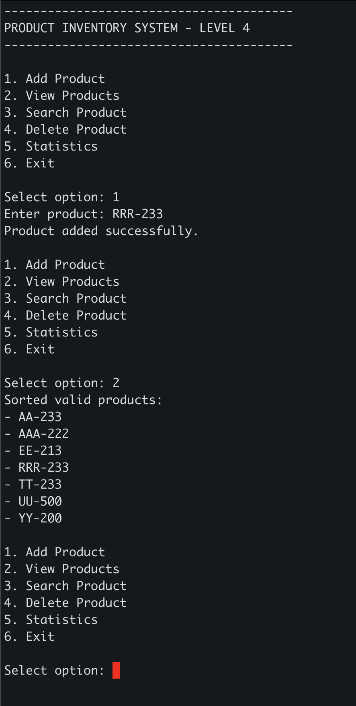

# Asset Tracking System

A C# console app for tracking company computers and mobile phones.

## Get started

1. Install the [.NET 10 SDK](https://dotnet.microsoft.com/download/dotnet/10.0).
2. Open a terminal in this project folder and run:

   ```sh
   make run
   ```

   `make run` initializes the pinned [sharp-storage](https://github.com/rosenberg-c/sharp-storage) Git submodule first. If you're on Windows or not using Make, run `git submodule update --init --recursive` from the project folder after cloning, then run `dotnet run --project App.csproj`. The submodule uses a GitHub SSH URL, so GitHub SSH access must be configured. Alternatively, clone with `git clone --recurse-submodules <repo-url>` to initialize the submodule during cloning.

3. Choose a menu option. Type `q` to quit the menu or cancel asset entry. The app also quits if input ends.

## Using the app

- **Show List (1):** Choose to display assets by office or purchase date. The table shows type, brand, model, purchase date, USD and local prices, and office.
- **Add New (2):** Choose a computer or mobile phone, then enter brand, model, purchase date, USD and local prices, and office. Enter `q` to cancel at any prompt.

Brand, model, and office cannot be empty. Prices must be non-negative numbers in your system's number format. Dates use `yyyy-MM-dd`. The app saves assets to `assets.json` in the folder where you run it; run it from the same folder next time to keep your assets. Use `make reset` to copy the sample `assets.example.json` to that path (overwrites existing data).

## Existing asset files

The current `assets.json` schema is version 1. On startup, the app rejects unsupported schema versions or invalid JSON instead of changing them. Existing files from earlier office-based prototypes are not compatible with the current asset model; keep a backup before using another data file.

## VS Code

For vscode users the extension "C# Dev Kit" from Microsoft may need to be installed


## Formatting prerequisite

Install the JetBrains CLI for `make format`:

```sh
dotnet tool install -g JetBrains.ReSharper.GlobalTools
export PATH="$PATH:$HOME/.dotnet/tools" # If jb is not on PATH
```

## Tests and code style

From the project folder, run:

```sh
make build   # Build app and storage dependency
make test    # Run tests
make lint    # Check .NET formatting without changing files
make format  # Format app and tests with JetBrains ReSharper
```

`make format` uses the checked-in `App.sln`; add new projects with `dotnet sln App.sln add path/to/New.csproj` (no update needed for new `.cs` files). `make lint` uses `dotnet format` and does not check JetBrains-specific wrapping. `tests/apptests` covers app-wide startup and shared console behavior. `tests/assettests` covers asset workflows through `tests/assetshost`, an asset-only executable that runs the asset menu directly. Without Make, run `dotnet test tests/apptests/App.Integration.Tests.csproj` or `dotnet test tests/assettests/App.Tests.csproj` separately. `make test` runs both suites.

## Make

Easy make commands

```sh
make deps
make run
make test
make lint
make format
```

## Running

[](assets/run.png)
