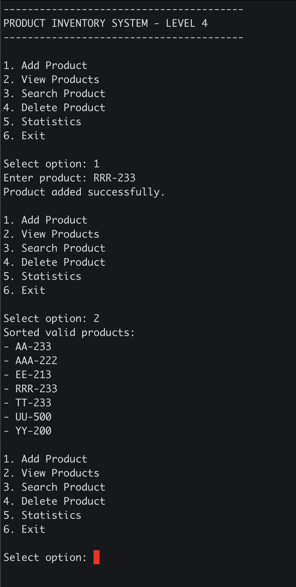

# Product Inventory System

A small console app for managing products.

## Get started

1. Install the [.NET 10 SDK](https://dotnet.microsoft.com/download/dotnet/10.0).
2. Open a terminal in this project folder and run:

   ```sh
   dotnet run --project ProdList.csproj
   ```

3. Choose a menu option to add, view, search, or delete products, or see statistics. Enter `6` or type `exit` to quit.

Product names use uppercase letters followed by a dash and a number from 200 to 500 (for example, `AB-300`). Search by name or number. Products are saved to `products.json` in the folder where you run the app, so run it from the same folder next time to keep your list.

## VS Code

For vscode users the extension "C# Dev Kit" from Microsoft may need to be installed


## Linting

```sh
Install ReSharper tools
dotnet tool install -g JetBrains.ReSharper.GlobalTools

Add tools to PATH (if needed)
export PATH="$PATH:$HOME/.dotnet/tools"
```


## Tests and code style

From the project folder, run:

```sh
make test    # Run tests
make lint    # Check formatting without changing files
make format  # Format app and test code
```

These commands use the .NET SDK. `make` is also required; if you don't have it, run `dotnet test tests/ProdList.Tests.csproj` for tests or see the equivalent `dotnet format` commands in the `Makefile`.

## Make

Easy make commands

```sh
make run
make test
make lint
make format
```

## Running

[](assets/run.png)
